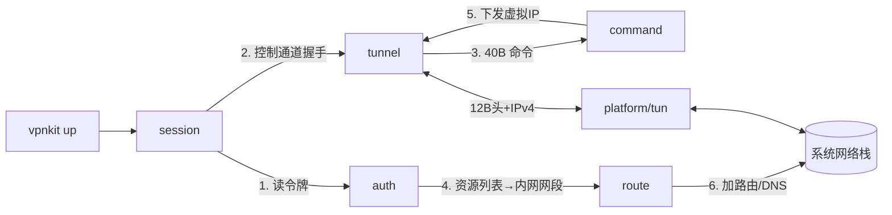
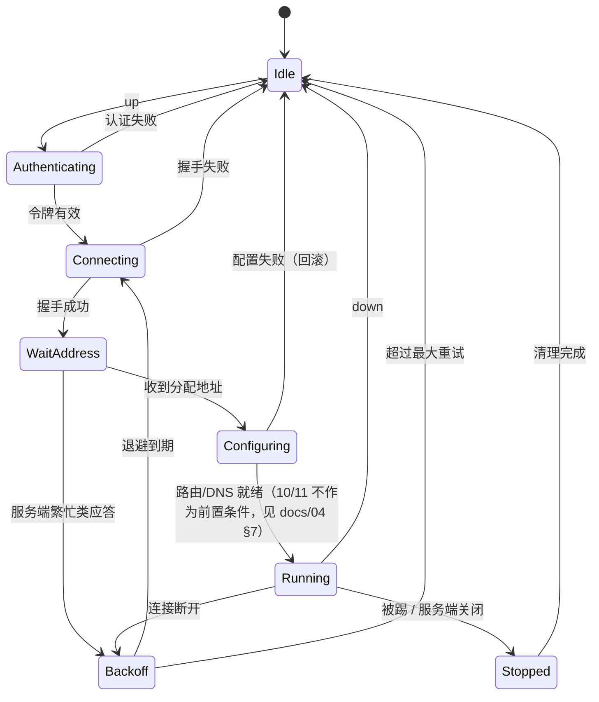

# 01 · 架构

## 1. 分层

```
┌─────────────────────────────────────────────┐
│ cmd/vpnkit            CLI、参数、退出码       │
├─────────────────────────────────────────────┤
│ internal/session      会话编排、状态机驱动     │
├──────────────┬──────────────┬───────────────┤
│ internal/auth│internal/tunnel│internal/command│
│  认证协议     │ 握手/帧/RC4   │ 命令分发       │
├──────────────┴──────────────┴───────────────┤
│ internal/route        路由与 DNS 变更         │
├─────────────────────────────────────────────┤
│ internal/platform     TUN 设备、系统调用封装   │
├─────────────────────────────────────────────┤
│ pkg/wire              纯字节编解码（无依赖）   │
└─────────────────────────────────────────────┘
```

**依赖方向只能向下。** 上层可以 import 下层，反之禁止。`pkg/wire` 不 import 任何 `internal/*`。

## 2. 数据流



一次 `up` 的完整时序：

1. 读本地令牌，必要时刷新；无令牌 → 退出码 3
2. 向网关发起控制通道：握手 → 收到服务端确认
3. 发「请求分配地址」命令，收到 40 字节应答
4. 从应答解析出虚拟 IP、`enc`/`zip`/`udpport`；内网网段来自认证阶段取得的资源列表（`docs/09` §4）
5. 创建 TUN 设备，配置虚拟 IP 与 MTU
6. 只针对内网网段加路由；配置分区 DNS
7. 启动收发 goroutine，进入 `RUNNING`
8. 启动心跳

`down` 严格逆序执行，且**每一步都要能单独成功**（幂等）。

## 3. 并发模型

| goroutine | 职责 | 退出条件 |
|---|---|---|
| `ctrlLoop` | 读控制通道 40 字节命令，驱动状态机 | context 取消或连接断开 |
| `txLoop` | TUN → 加帧头 → 加密 → 隧道 | context 取消 |
| `rxLoop` | 隧道 → 拆帧头 → 解密 → TUN | context 取消 |
| `heartbeat` | 周期发送心跳 | context 取消 |
| `watchdog` | 检测对端静默 / 网络切换 | context 取消 |

规则：

- 所有 goroutine 共享一个 `context.Context`，`down` 时统一 `cancel()`
- 任一 goroutine 因**不可恢复错误**退出时，必须 cancel 整个 context（用 `errgroup` 或手动 channel）
- 不允许 goroutine 泄漏：`down` 返回前必须 `WaitGroup.Wait()`，超时则报错

## 4. 状态机



对外暴露的状态字符串（`status` 输出）：`idle`、`authenticating`、`connecting`、`wait_address`、`configuring`、`running`、`backoff`、`stopped`。

## 5. 回滚

`up` 期间任何一步失败，按已完成的步骤逆序回滚：

| 已完成 | 回滚动作 |
|---|---|
| 加过路由 | 删除这些路由 |
| 改过 DNS | 恢复原始解析配置快照 |
| 建过 TUN | 关闭设备句柄 |
| 建过连接 | 关闭 socket |

启动时先写一份 `~/.config/vpnkit/state.json` 记录将要做的变更；正常退出时删除。**若启动时发现该文件已存在，说明上次异常退出**，先按它记录的内容清理再继续。

## 6. 错误分类

| 类型 | 处理 |
|---|---|
| 可重试（网络抖动、超时、服务端繁忙） | 退避重连，不退出 |
| 需重新认证（令牌过期） | 转 `Idle`，退出码 3 |
| 终态（被踢、账号冲突、权限不足） | 转 `Stopped`，退出码 7 |
| 配置类（路由失败、TUN 创建失败） | 回滚并退出，退出码 6 |

服务端返回的具体错误码见 `docs/04` §1。
