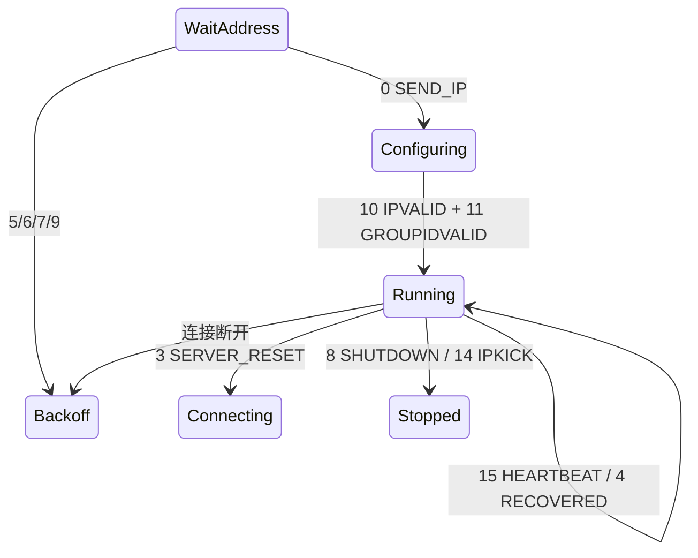

# 04 · 命令状态机

控制通道上，服务端每发一条命令就是一个 40 字节消息（格式见 `docs/03` §4.2）。命令码在偏移 4。

## 1. 命令表

| code | 名称 | 客户端应做什么 |
|---:|---|---|
| **0** | `SEND_IP` | **分配地址**：解析虚拟 IP、内网网段、`enc`/`zip`/`udpport`，进入配置阶段 |
| 3 | `SERVER_RESET` | 重置会话：立即重连（不退避） |
| 4 | `RECOVERED` | 会话已恢复：仅记录，继续运行 |
| 5 | `RECONNECTLATER_IPISBUSY` | 虚拟 IP 被占：退避后重连 |
| 6 | `RECONNECTLATER_MEMORYPOOL` | 服务端内存池耗尽：退避后重连 |
| 7 | `RECONNECTLATER_SYSTEMISBUSY` | 服务端繁忙：退避后重连 |
| 8 | `SHUTDOWN` | 服务端强制断开：转 `Stopped`，退回退出码 7 |
| 9 | `RECONNECTLATER_CONFLICT` | 地址冲突：退避后重连（退避时间应更长） |
| 10 | `IPVALID` | 虚拟 IP 校验通过：可进入 `Running` |
| 11 | `GROUPIDVALID` | 组 ID 校验通过：可进入 `Running` |
| 14 | `IPKICK` | **被踢下线**：转 `Stopped`，打印原因 |
| 15 | `HEARTBEAT` | 心跳：无需应答，刷新对端活跃时间 |

code `1`、`2`、`12`、`13` 未使用，收到时按未知命令处理（记录并忽略，**不要**断开连接）。

## 2. 消息结构

```
+0   "AABB"
+4   int32  command code
+8   ...    命令参数
```

`SEND_IP` 之外，其他命令目前只用到命令码本身。未知字段一律忽略，不要因长度不符而报错（便于向前兼容）。

## 3. `SEND_IP` 参数

这是唯一带完整负载的命令。字段含义：

| 字段 | 类型 | 含义 | 用途 |
|---|---|---|---|
| `tapip` | string | 分配给本机的虚拟 IP | 配置 TUN 设备地址 |
| `lanip` | string | 本机在网关侧看到的出口 IP | 记录、排障 |
| `enc` | int | 是否启用数据加密 | 0 = 不加密，非 0 = RC4 |
| `zip` | int | 是否启用压缩 | 当前实现恒为 0，见 §3.1 |
| `udpport` | uint | UDP 承载端口 | 0 表示不支持 UDP 承载 |

### 3.1 关于 `zip`

当前已知实现里 `zip` 恒为 0，且数据帧的变换是**等长**的（RC4），因此**不存在压缩分支**。
实现时应：

- 保留 `zip` 字段的解析（向前兼容）
- 若 `zip != 0`，记录警告并**仍按无压缩处理**，不要尝试猜测压缩格式

### 3.2 关于内网网段

内网网段来自 `conf.csp` 的资源列表（`docs/09` §3），不在 `SEND_IP` 消息里。
两者都要解析：`SEND_IP` 给本机地址，资源列表给路由目标。

## 4. 心跳

| 方向 | 说明 |
|---|---|
| 服务端 → 客户端 | 命令码 15，无需应答，仅刷新活跃时间 |
| 客户端 → 服务端 | 周期发送，具体字节内容与命令通道上其他报文一致 |

参数建议（**保守默认，可配置**）：

```toml
[tunnel]
heartbeat_interval = "10s"    # 发送间隔
heartbeat_timeout  = "30s"    # 超过此时间未收到任何服务端消息则判定掉线
```

规则：

- 心跳**双向**都要做。只做客户端单侧会导致对端静默超时。
- `heartbeat_timeout` 内没有任何入站字节（不只是心跳）才判定掉线。
- 心跳发送失败一次不立即重连；连续 3 次失败才重连。

## 5. 重连策略

| 触发 | 退避 | 最大重试 |
|---|---|---|
| `SERVER_RESET`(3) | 立即 | ∞（但受总时长限制） |
| `RECONNECTLATER_IPISBUSY`(5) | 5s → 10s → 20s → 40s → 60s 封顶 | 6 |
| `RECONNECTLATER_MEMORYPOOL`(6) | 同上 | 6 |
| `RECONNECTLATER_SYSTEMISBUSY`(7) | 同上 | 6 |
| `RECONNECTLATER_CONFLICT`(9) | 30s 起，双倍递增，300s 封顶 | 4 |
| 网络断开（非服务端原因） | 2s → 4s → 8s → 16s → 30s 封顶 | ∞ 直到用户 `down` |
| `SHUTDOWN`(8) / `IPKICK`(14) | **不重连** | — |

超过最大重试 → 回滚并退出，退出码 7。

退避必须带抖动（±20%），避免多客户端同时重连。

## 6. 被踢下线

三种原因，日志与 `status` 都要区分：

| 原因 | 说明 |
|---|---|
| normal | 同一账号在别处登录（顶号） |
| session switch | 会话被切换到其他线路/节点 |
| generic | 其他，带一个原因码 |

处理：转 `Stopped`，打印明确提示（「账号已在其他位置登录」），**不要**自动重连——否则会和另一端来回互踢。

## 7. 状态转换



## 8. 测试用例

| 用例 | 期望 |
|---|---|
| 收到 0，字段齐全 | 进入 `Configuring`，解析出正确 IP 与网段 |
| 收到 0，`tapip` 非法 | 回滚，退出码 6 |
| 收到 5 | 进入 `Backoff`，5 秒后重连 |
| 收到 14 | 进入 `Stopped`，退出码 7，不重连 |
| 收到未知码 99 | 记录日志，连接保持，状态不变 |
| 心跳超时 | 判定掉线，进入 `Backoff` |
| 连续 3 次心跳发送失败 | 立即重连 |
